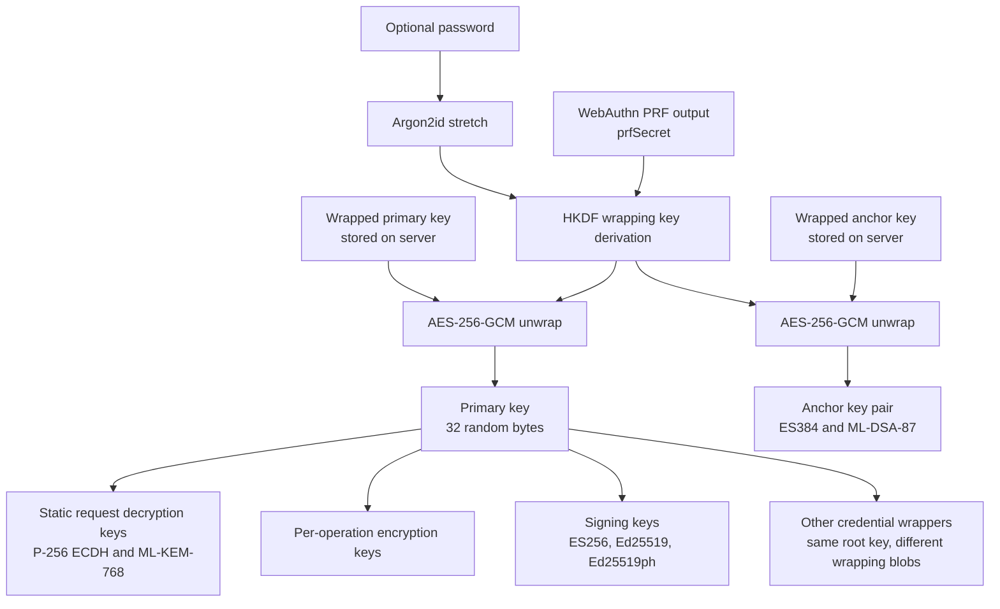
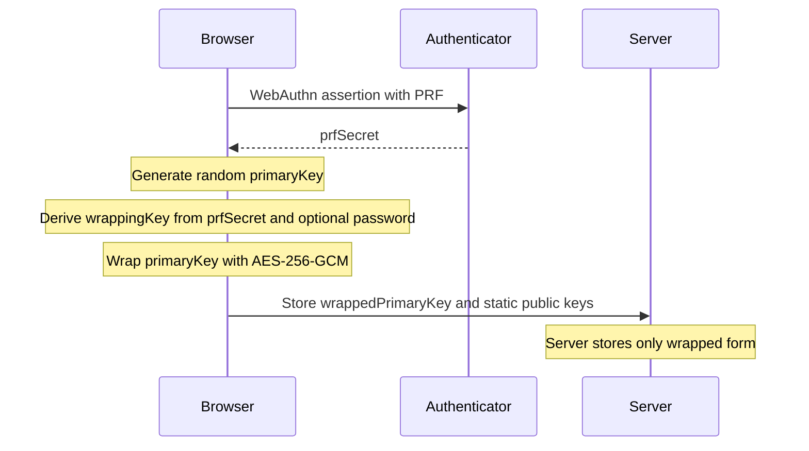
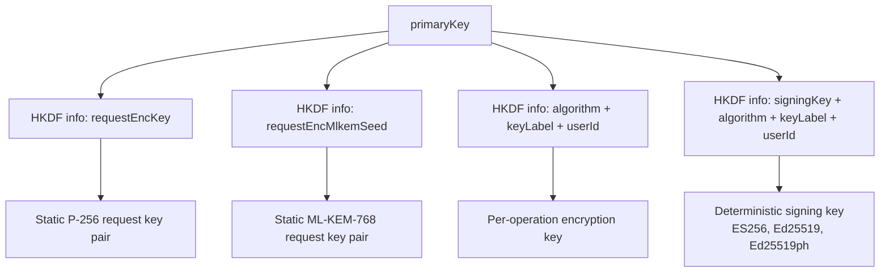
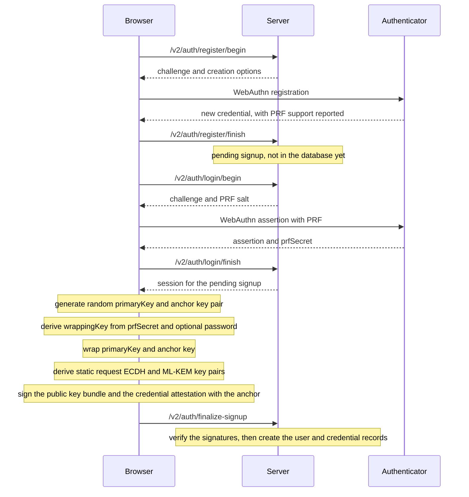
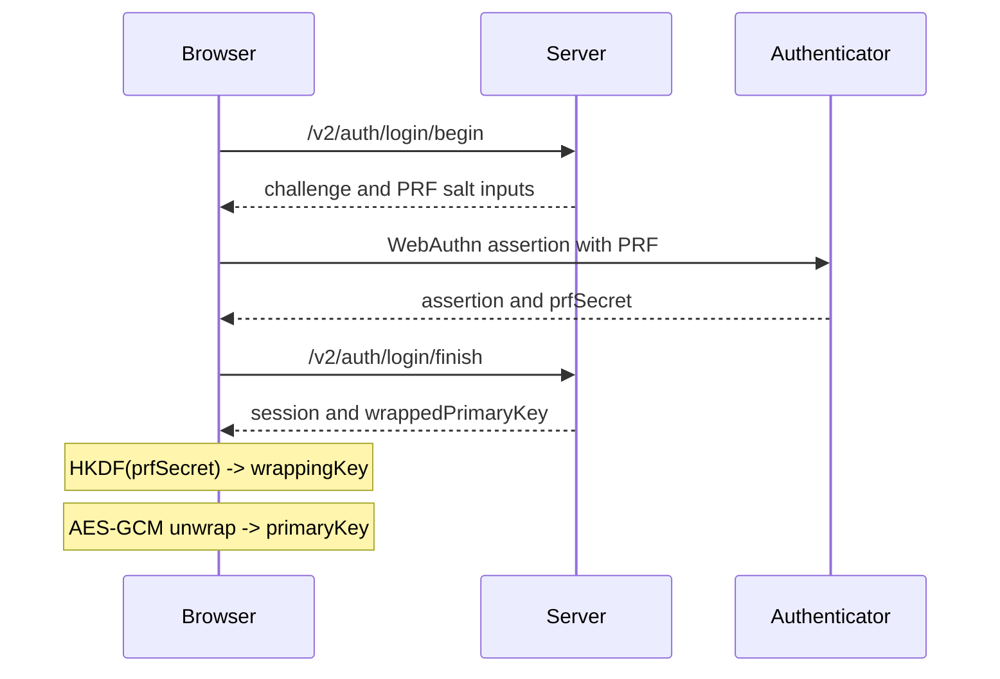
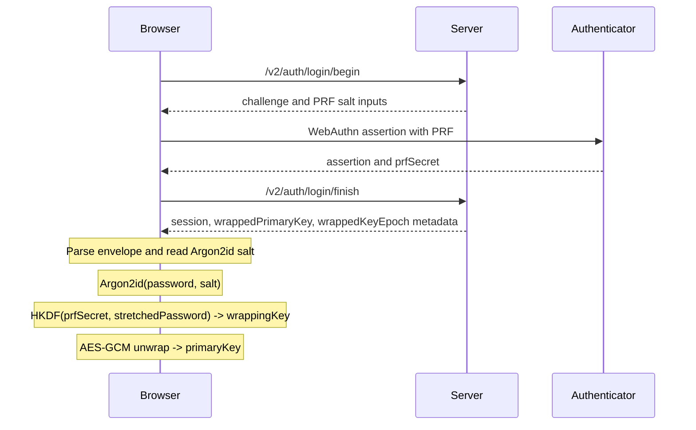
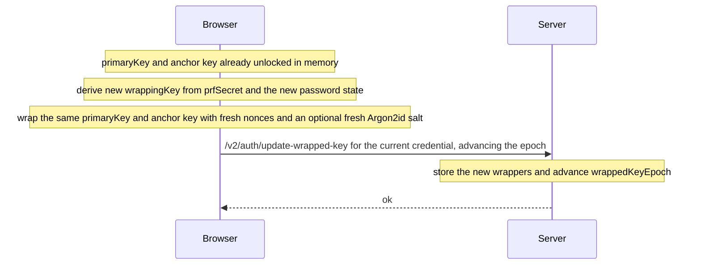
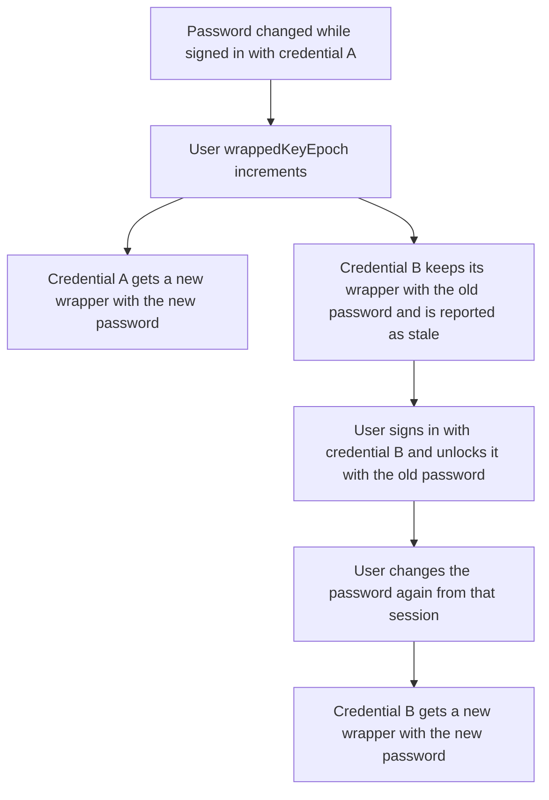
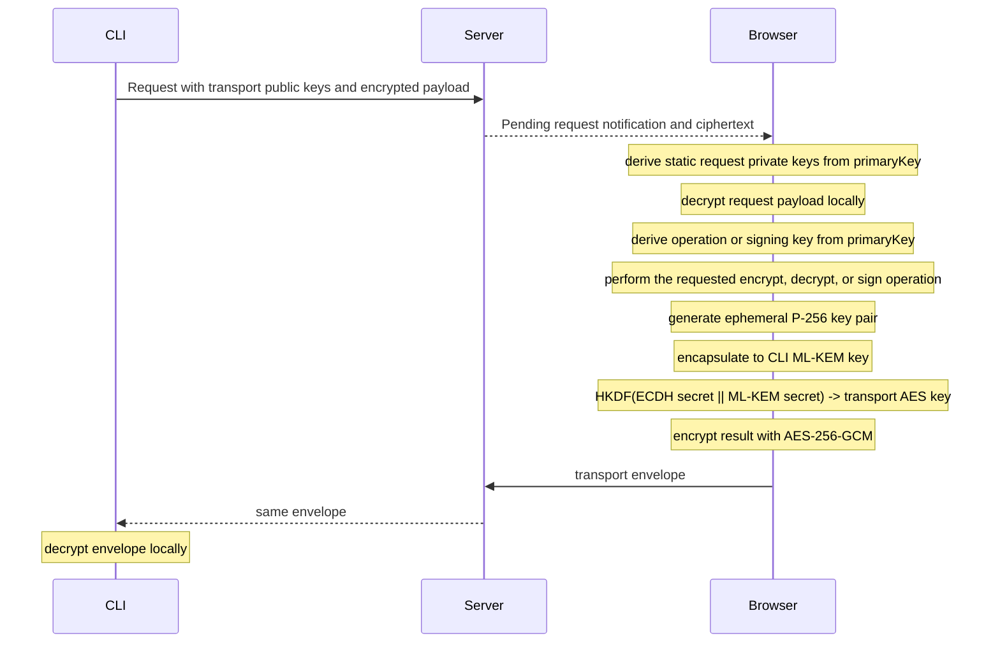

This document describes the cryptography Revaulter v2 uses in the browser client, the CLI protocol, and the server's storage model.
It focuses on how WebAuthn PRF, WebCrypto, optional passwords, the primary key, and request and response envelopes fit together.

Revaulter is designed so the server relays and stores encrypted material, while the browser performs the sensitive cryptographic operations.
The server never derives the user's primary key, never performs the requested encryption or decryption itself, and never sees plaintext payloads.

## High-level model

Revaulter has three key layers:

1. `prfSecret`: a 32-byte secret returned by the authenticator through the WebAuthn PRF extension during login
2. `primaryKey`: a random 32-byte root key generated in the browser and stored on the server only in wrapped form
3. Derived keys: deterministic keys derived from the `primaryKey` for request decryption, application encryption and decryption, and signing

Each account also has a random [anchor key pair](#anchor-key), which is wrapped alongside the `primaryKey` and signs the account's public keys.



## Browser-side crypto and WebCrypto usage

The browser uses WebCrypto for:

- Generating the random 256-bit `primaryKey`
- HKDF-SHA-256 derivation for wrapping keys, request and transport encryption keys, operation keys, and signing keys
- AES-256-GCM wrap and unwrap of the `primaryKey` and the anchor key
- AES-256-GCM for request and response envelopes, and for application encrypt and decrypt operations
- ECDSA P-384 (ES384) key generation and signing for the anchor key

Outside WebCrypto, the browser uses:

- WebAuthn with the PRF extension to get `prfSecret`
- [`@awasm/noble`](https://github.com/paulmillr/awasm-noble) for Argon2id (password stretching) and ChaCha20-Poly1305 (application encrypt/decrypt operations)
- [`@noble/post-quantum`](https://github.com/paulmillr/noble-post-quantum) for ML-KEM-768 in the hybrid request and response encryption, and ML-DSA-87 for the anchor key
- [`@noble/curves`](https://github.com/paulmillr/noble-curves) for P-256 ECDH, and for signing with ES256, Ed25519 and Ed25519ph

Why the split:

- WebCrypto covers AES-GCM, HKDF, and ES384 with the browser's native implementation
- WebCrypto doesn't offer ChaCha20-Poly1305, Argon2id, ML-KEM, or ML-DSA, so those come from `@awasm/noble` and `@noble/post-quantum`
- WebCrypto always hashes its input before signing, so ECDSA P-256 signing uses `@noble/curves` to sign the 32-byte SHA-256 digest as is, which matches standard ES256 verification

## WebCrypto security notes

Because the cryptography runs in the browser, Revaulter's security depends partly on the integrity of the browser environment.

Constraints:

- WebCrypto must run in a secure context, which in practice means `https://` or `http://localhost`
- The app sets a Content Security Policy to reduce the risk of script injection around the crypto code. If you run your own proxy in front of Revaulter, make sure it preserves the CSP headers

Even with these mitigations, some risk remains, because the code that handles secrets runs in a general-purpose client runtime:

- A malicious script running in the page could read plaintext inputs, the in-memory `primaryKey`, or operation results before they're re-encrypted. To limit this, the primary key is kept only in memory, never in local storage, session storage, or cookies
- Browser extensions, compromised dependencies, browser bugs, or a compromised device can weaken the security of in-browser cryptography
- Revaulter reduces server-side exposure, but you still have to trust the browser and the device it runs on

## Primary key lifecycle

The `primaryKey` is the root secret for a user account.
It is generated once in the browser during setup and reused across passkeys by re-wrapping it for each credential.

Properties:

- Size: 32 bytes
- Generation: random, in the browser, through WebCrypto
- Storage: only as a wrapped blob on the server
- Exposure: held in browser memory after a successful sign-in or password unlock



## Wrapping key derivation

The wrapping key is what encrypts and authenticates the `primaryKey` and the anchor key for storage.
It is derived from two factors:

- Required factor: `prfSecret` from WebAuthn PRF
- Optional factor: user password

### Without a password

The wrapping key is derived directly from the PRF output with HKDF-SHA-256:

```text
wrappingKey = HKDF-SHA-256(
  IKM  = prfSecret
  salt = empty
  info = "revaulter/v2/primaryKeyWrap\nuserId={userId}\nv=1"
  len  = 32 bytes
)
```

### With a password

The password is first stretched with Argon2id, and the result becomes the HKDF salt:

```text
stretched = Argon2id(
  password,
  salt = 16 random bytes,
  m = 128 MiB,
  t = 4,
  p = 1,
  hashLen = 32
)

wrappingKey = HKDF-SHA-256(
  IKM  = prfSecret,
  salt = stretched,
  info = "revaulter/v2/primaryKeyWrap\nuserId={userId}\nv=1",
  len  = 32 bytes
)
```

Why this construction:

- The PRF output is a high-entropy secret that only the authenticator can produce
- The password adds a second factor without becoming the direct encryption key
- Argon2id makes offline password guessing expensive for an attacker who obtains both a wrapped key blob and its PRF secret, for example by compromising the passkey
- Including the `userId` in the HKDF `info` keeps wrapping keys for different accounts independent

## Wrapped primary key format

The primary key is wrapped with AES-256-GCM.

Parameters:

- Key: 32-byte `wrappingKey`
- Nonce: random 12 bytes
- Plaintext: 32-byte `primaryKey`
- AAD: `revaulter/v2/wrapped-primary-key\nuserId={userId}\nv=1`

The stored blob is a base64url-encoded JSON envelope.
When there's a password:

```json
{
  "v": 1,
  "passwordRequired": true,
  "argon2id": {
    "m": 131072,
    "t": 4,
    "p": 1,
    "salt": "<base64url>"
  },
  "nonce": "<base64url>",
  "ciphertext": "<base64url>"
}
```

Without a password:

```json
{
  "v": 1,
  "passwordRequired": false,
  "nonce": "<base64url>",
  "ciphertext": "<base64url>"
}
```

At sign-in, a successful AES-GCM unwrap is both the passkey check and the password check.

## Deriving keys from the primary key

After unwrapping the `primaryKey`, the browser derives every other account-level key from it with HKDF-SHA-256.
Each derivation uses an empty HKDF salt and a purpose-specific `info` string.

### Request decryption ECDH key pair

The browser derives a stable request-encryption P-256 ECDH private scalar from the `primaryKey`.

Process:

1. HKDF derives 384 bits with `info = revaulter/v2/requestEncKey\nuserId={userId}\nv=1`
2. The 384-bit output is reduced to a valid P-256 scalar using the FIPS 186-5 candidate-reduction method
3. The scalar is used directly as the P-256 ECDH private key, through `@noble/curves`
4. The corresponding public key is stored on the server during signup finalization

Deriving 384 bits instead of 256 is deliberate: it keeps the modular reduction bias negligible when mapping the HKDF output into the P-256 scalar field.

### Request decryption ML-KEM key pair

The browser also derives a stable ML-KEM-768 key pair from the same `primaryKey`.

Process:

1. HKDF derives 512 bits with `info = revaulter/v2/requestEncMlkemSeed\nuserId={userId}\nv=1`
2. That seed is used to deterministically derive the ML-KEM-768 key pair
3. The public key is stored on the server during signup finalization

These two static public keys let the CLI encrypt request payloads end-to-end to the browser without the server being able to decrypt them.

### Operation keys

For each encrypt or decrypt request, the browser derives a 256-bit operation key from the `primaryKey` with:

```text
info = "algorithm={algorithm}\nkeyLabel={keyLabel}\nuserId={userId}\nv=1"
```

Each combination of label and algorithm gets its own deterministic operation key from the same root key.

The browser and the server both accept JOSE-style (`A256GCM`, `C20P`) and long-form (`aes-256-gcm`, `chacha20-poly1305`) algorithm names, case-insensitively.

Before the algorithm name goes into the HKDF `info`, it's converted to its long form (`aes-256-gcm` or `chacha20-poly1305`).
So encrypt and decrypt can use different accepted spellings and still derive the same operation key.
The AAD strings (transport AAD and request-encryption AAD) still use the name exactly as given, so the CLI and the browser must use the same spelling within a single request.

AES-256-GCM comes from WebCrypto, while ChaCha20-Poly1305 is provided by `@awasm/noble`.

### Signing keys

For the `sign` operation, the browser derives a deterministic signing key from the `primaryKey`.
Revaulter supports ES256 (ECDSA P-256), Ed25519, and Ed25519ph.

All three use the same HKDF `info` format, which includes the algorithm, so each algorithm gets a different key for the same label:

```text
info = "revaulter/v2/signingKey\nalgorithm={algorithm}\nkeyLabel={keyLabel}\nuserId={userId}\nv=1"
```

For ES256:

1. HKDF derives 384 bits
2. The output is reduced to a valid P-256 scalar using the FIPS 186-5 Appendix A.2.1 candidate-reduction method
3. `@noble/curves` signs the 32-byte SHA-256 digest with that scalar, with no additional hashing

For Ed25519 and Ed25519ph:

1. HKDF derives 256 bits, which become the Ed25519 private key seed
2. Ed25519 signs the message itself
3. Ed25519ph signs the 64-byte SHA-512 digest of the message, as defined in RFC 8032, without hashing it again

This `info` string differs from `revaulter/v2/requestEncKey`, `revaulter/v2/requestEncMlkemSeed`, and the operation-key format, so signing keys are independent of every other kind of key.
Deriving the same scalar as another kind of key is computationally infeasible.

Key stability:

- The signing key is a pure function of `primaryKey`, `userId`, `keyLabel`, and `algorithm`
- Password changes and credential changes only re-wrap the `primaryKey`; they do not change it
- Because of that, published signing public keys stay the same across password changes and passkey changes
- The browser does not cache derived signing keys on disk: they are re-derived from the in-memory `primaryKey` as needed



### Publication of signing public keys

Signing public keys can optionally be published on the server so external verifiers can fetch them by a stable key ID.

- The key ID is the RFC 7638 JWK thumbprint of the public key: the base64url-encoded SHA-256 of the canonical JSON `{"crv":"P-256","kty":"EC","x":"…","y":"…"}` for ES256 keys, or `{"crv":"Ed25519","kty":"OKP","x":"…"}` for Ed25519 and Ed25519ph keys
- When the web client publishes a key, it also stores a publication proof signed by the [anchor](#anchor-key), so verifiers who pinned the anchor can check that the key belongs to the account
- There's no soft delete or revocation list: verifiers should treat a 404 for a known key ID as a revocation
- Public endpoints are unauthenticated and take only the opaque key ID; there is no listing or enumeration endpoint

## Anchor key

Each account has an anchor key pair, which acts as the account's long-lived identity.
It's a hybrid pair: an ECDSA P-384 (ES384) key and an ML-DSA-87 key.
Every anchor signature consists of one signature from each key, and both must verify.

The browser generates both keys at random during signup, so they aren't derived from the `primaryKey`.
For ML-DSA-87, the browser keeps the 32-byte seed and regenerates the key pair from it when signing.

The anchor's private keys are wrapped with the same wrapping key as the `primaryKey`, in a separate AES-256-GCM blob with AAD `revaulter/v2/wrapped-anchor\nuserId={userId}\nv=1`.
As with the `primaryKey`, each credential stores its own wrapped copy.
The server stores the anchor public keys.

The anchor signs:

- The public key bundle: the account's static request public keys (ECDH and ML-KEM), together with the anchor public keys
- An attestation for each passkey, covering the credential ID and a hash of the credential's public key
- Signing key publications, which tie a published signing key ID to the account

Each signed message starts with a fixed prefix (`revaulter/v2/pubkey-bundle\n`, `revaulter/v2/cred-attest\n`, or `revaulter/v2/signing-key-publication\n`), so a signature made for one purpose can't be used for another.

The server verifies each of these signatures when it receives it.  
Clients such as `revaulter-cli`, `revaulter-edit`, and the Go library pin the anchor the first time they connect to a server.  
Before encrypting each request, they check that the public key bundle is signed by the pinned anchor, so a server can't swap in request keys of its own.

The anchor fingerprint that users compare when pinning is the hex-encoded SHA-256 of the ES384 public key (as an uncompressed point) followed by the ML-DSA-87 public key.

## Signup flow

Signup happens in two phases.
After the passkey is registered, the server keeps the account as a pending signup, and creates the user and credential records only when the browser has finished its local cryptographic setup and calls `finalize-signup`.

Registration doesn't evaluate the PRF, so right after registering the passkey the browser signs in with it to get `prfSecret`.



After finalization the server stores:

- A user record with request routing metadata, the user-level `wrappedKeyEpoch`, the static request public keys, the anchor public keys, and the signed public key bundle
- A credential record with that credential's `wrappedPrimaryKey`, `wrappedAnchorKey`, and attestation

## Login and unlock flow

### Passwordless account

If the wrapped envelope says `passwordRequired: false`, login is a one-step unwrap after WebAuthn:



### Password-protected account

If the wrapped envelope says `passwordRequired: true`, login becomes a WebAuthn step followed by local password unlock:



Notes:

- The password is used exactly as entered, with no trimming or normalization
- A wrong password, like any other unlock failure, shows up only as an AES-GCM authentication failure during unwrap

## Changing or removing the password

Changing the password does not change the `primaryKey`.
It only changes how that same `primaryKey` is wrapped for the credential you signed in with.

Steps:

1. The browser must already have `prfSecret`, the unwrapped `primaryKey` and anchor key, and the active credential ID in memory
2. The browser derives a new wrapping key from the passkey's `prfSecret` and the new password, or no password if removing it
3. The browser wraps the same `primaryKey` and anchor key with the new wrapping key, using fresh nonces and, when applicable, a fresh Argon2id salt
4. The browser uploads the new wrapped blobs, only for the credential you signed in with
5. The server stores them and advances the user-level `wrappedKeyEpoch`



This is a re-wrap, not a re-key:

- The account root key stays the same
- Derived operation keys stay the same
- Existing encrypted data does not need to be re-encrypted

## Multi-passkey behavior and wrapped-key epochs

Each credential stores its own wrapped copy of the same `primaryKey`.  
That is necessary because each passkey yields a different `prfSecret`, so each credential needs its own wrapper.  
The optional password also goes into each wrapper's key, so the password is effectively set per passkey.

Behavior when the password is set, changed, or removed:

- Only the wrapper of the credential used to make the change is updated
- Other credentials keep their existing wrapper, so they keep unlocking with the password they had before, or with no password
- To update another credential, sign in with it, unlock it with its current password, and change the password again from that session
- A credential added while signed in is wrapped with the password of the session it was added from

> ⚠️ **Warning:** Changing the password doesn't revoke the old password on other passkeys. Anyone who has one of those passkeys and knows its old password can still unlock the primary key. If a password may have leaked, change it while signed in with each passkey, and delete any passkey you can't update.

The user record stores a `wrappedKeyEpoch` that advances on every password change, and each credential records the epoch of its wrapper.  
When a credential's epoch is older than the user's, the server reports it as stale, meaning the most recent password change was made with a different credential.  
It doesn't re-wrap stale credentials automatically: unlocking a stale wrapper requires its old password, so re-wrapping it at that point wouldn't apply the new one.



This means you don't need every passkey at hand to change the password, at the cost of the old password staying valid on passkeys that haven't been updated.

## Request encryption path

When the CLI submits an encrypt, decrypt, or sign request, it doesn't send the sensitive part of the request to the server in plaintext.
Instead, it encrypts it to the browser's static request keys, which are derived from the `primaryKey`.

At a high level:

1. Browser derives static request private keys from `primaryKey`
2. CLI uses the corresponding server-stored public keys to build an end-to-end encrypted request payload
3. Server stores and relays that ciphertext
4. Browser decrypts the request locally after the user approves it

To encrypt a request, the CLI generates an ephemeral P-256 key pair and runs ECDH against the account's static ECDH public key.  
It also encapsulates to the account's static ML-KEM-768 public key.  
The two shared secrets are concatenated and expanded with HKDF-SHA-256 (`info = "revaulter/v2/request-enc"`) into an AES-256-GCM key.

The request AAD is deterministic:

```text
aad = "algorithm={algorithm}\nkeyLabel={keyLabel}\noperation={encrypt|decrypt|sign}\nv=1"
```

Decryption fails if the algorithm, key label, or operation doesn't match the ones the request was encrypted for.

For `sign`, the inner payload carries the bytes to sign, encoded as base64url:

- ES256: the 32-byte SHA-256 digest of the message
- Ed25519ph: the 64-byte SHA-512 digest of the message
- Ed25519: the message itself, up to the maximum request payload size

For ES256 and Ed25519ph the CLI hashes the message itself, so the browser only sees the digest.
In every case, the server only sees the encrypted payload.

## Response transport encryption path

The browser sends the result back to the CLI through a separate transport envelope.
This path uses:

- Hybrid key agreement with P-256 ECDH and ML-KEM-768
- Key derivation with HKDF-SHA-256
- Encryption with AES-256-GCM

The browser generates a fresh ephemeral P-256 key pair for each response.
It also encapsulates to the CLI's ML-KEM public key.
The ECDH shared secret and ML-KEM shared secret are concatenated and expanded with HKDF into an AES-256-GCM key.

The transport HKDF `info` is:

```text
info = "revaulter/v2/transport/{state}"
```

The transport AAD is deterministic:

```text
aad = "algorithm={algorithm}\noperation={encrypt|decrypt|sign}\nstate={state}\nv=1"
```



Because both shared secrets feed the key derivation, an attacker has to break both P-256 ECDH and ML-KEM-768 to read a response.

## Algorithms in use

| Purpose | Algorithm |
| --- | --- |
| Secret from the authenticator | WebAuthn PRF |
| Password stretching | Argon2id (`m=128 MiB`, `t=4`, `p=1`, `hashLen=32`) |
| Key derivation | HKDF-SHA-256 |
| Wrapped primary key encryption | AES-256-GCM |
| Application encrypt/decrypt operation | AES-256-GCM (via WebCrypto) or ChaCha20-Poly1305 (via `@awasm/noble`), named JOSE-style (`A256GCM`, `C20P`) or long-form (`aes-256-gcm`, `chacha20-poly1305`), case-insensitive |
| Application sign operation | ES256 (ECDSA P-256), Ed25519, or Ed25519ph, via `@noble/curves` |
| Published signing key ID | RFC 7638 JWK thumbprint (SHA-256, base64url) |
| Anchor signatures | ES384 (ECDSA P-384, via WebCrypto) and ML-DSA-87 (via `@noble/post-quantum`), both required |
| Request key agreement | Hybrid ECDH P-256 and ML-KEM-768 |
| Request payload AEAD | AES-256-GCM |
| Response transport key agreement | Hybrid ECDH P-256 and ML-KEM-768 |
| Response transport AEAD | AES-256-GCM |

## Security properties and consequences

- The server cannot perform user cryptographic operations because it never has the unwrapped `primaryKey`
- The server can't substitute its own request keys for an account's, because clients check that the public key bundle is signed by the anchor they pinned
- A passkey change or password change normally requires only re-wrapping, not re-encrypting application data
- A successful unwrap authenticates the wrapper contents, the passkey-derived PRF input, and the optional password in one step
- Wrapping keys, static request keys, transport keys, and operation keys each use their own HKDF `info` string, so they are independent of each other
- The user ID and request metadata are part of the AAD or the HKDF `info`, so keys and ciphertexts can't be reused across contexts
