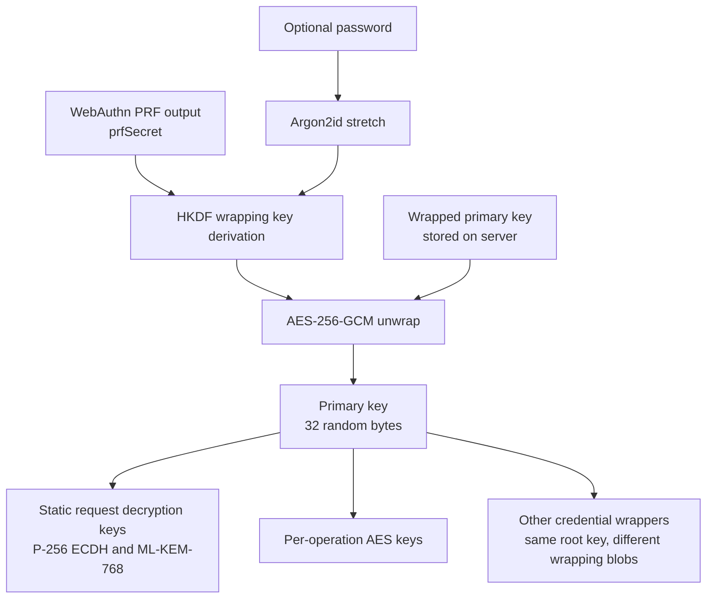
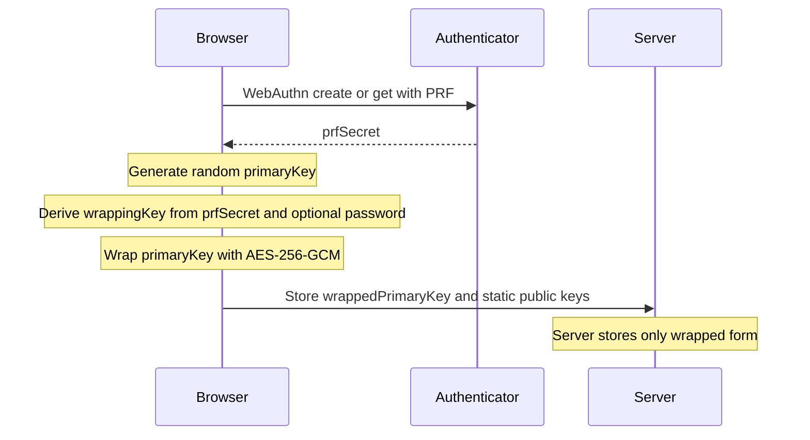
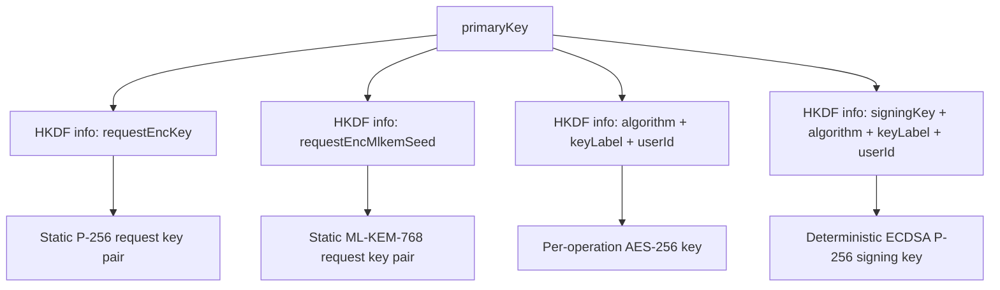
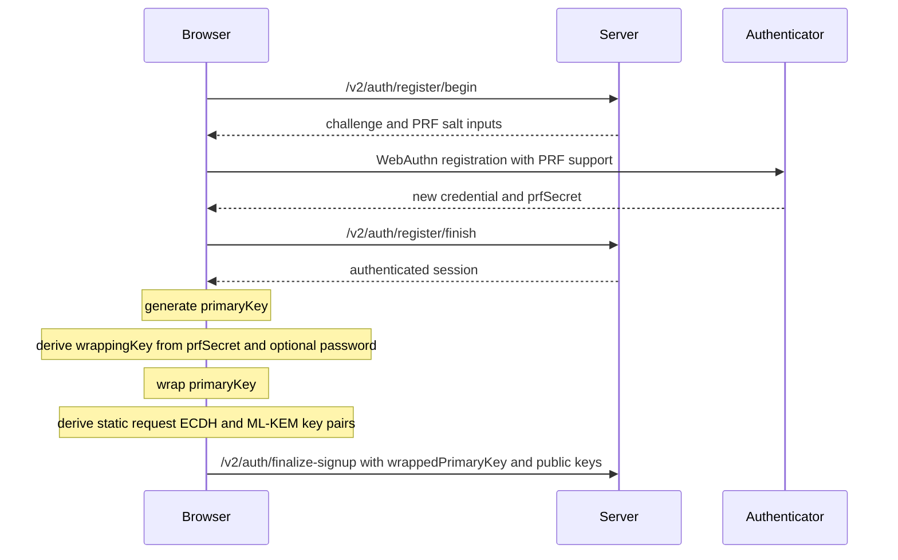
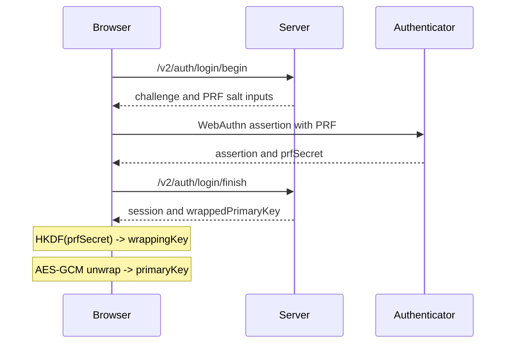
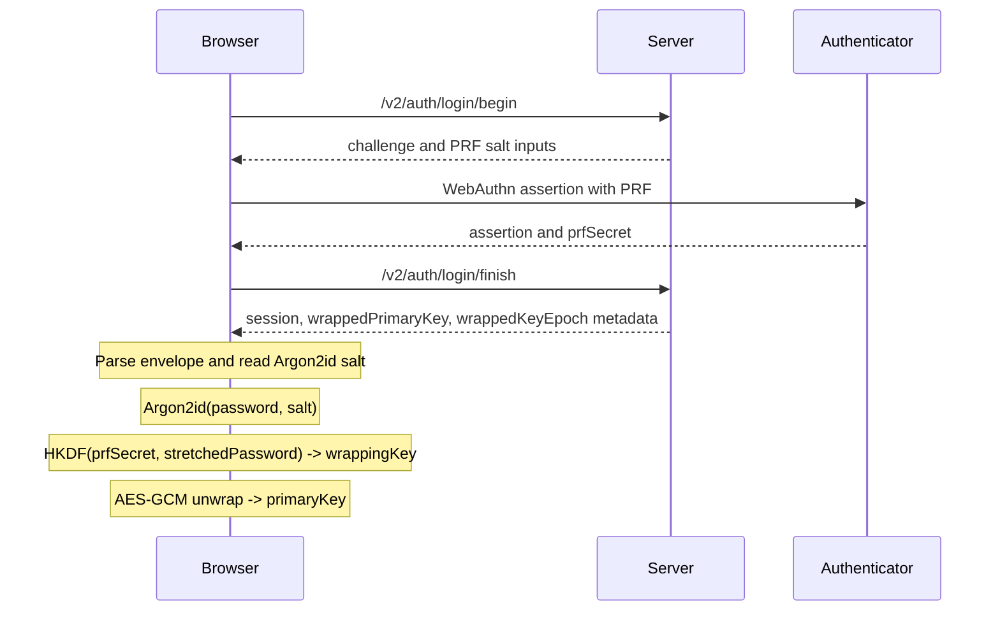
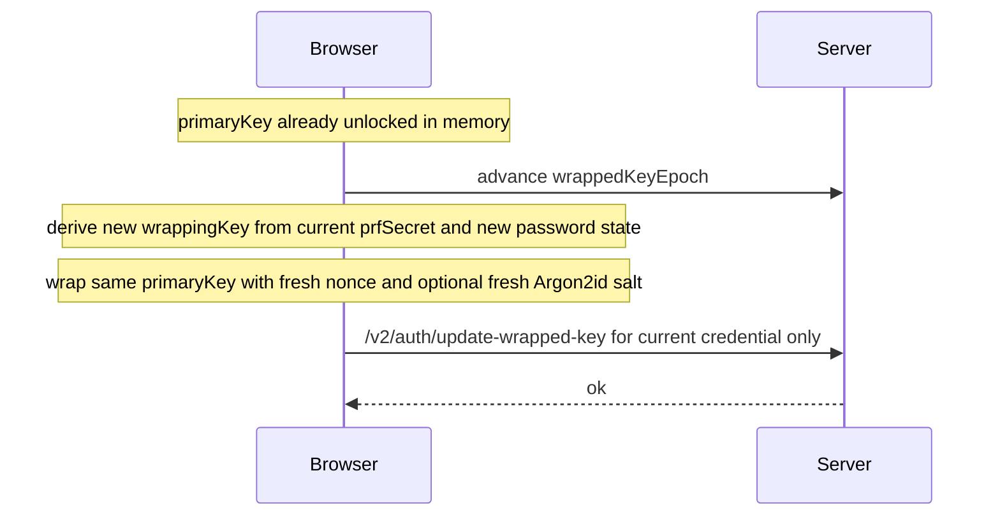
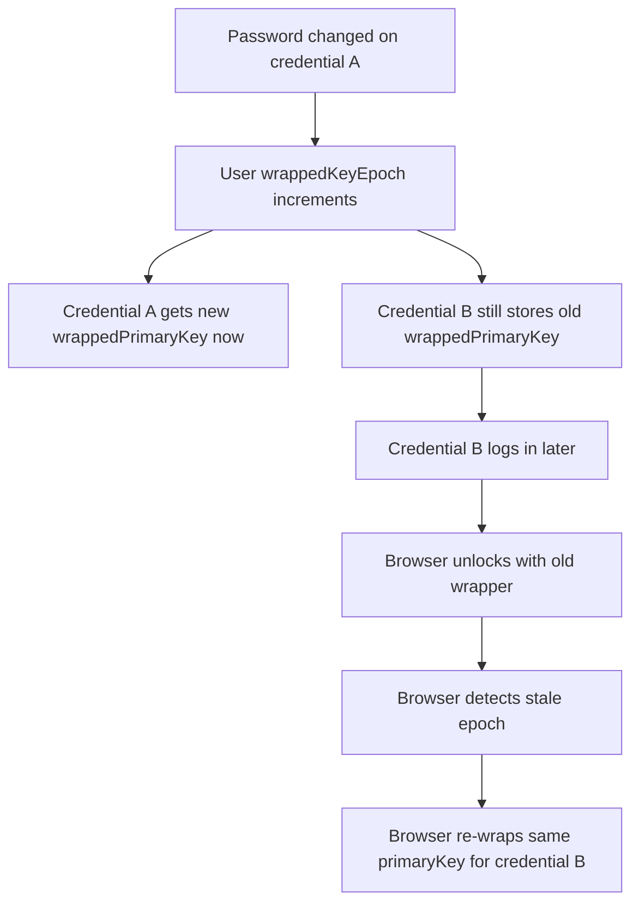
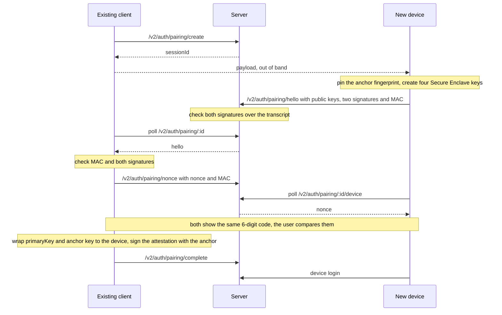
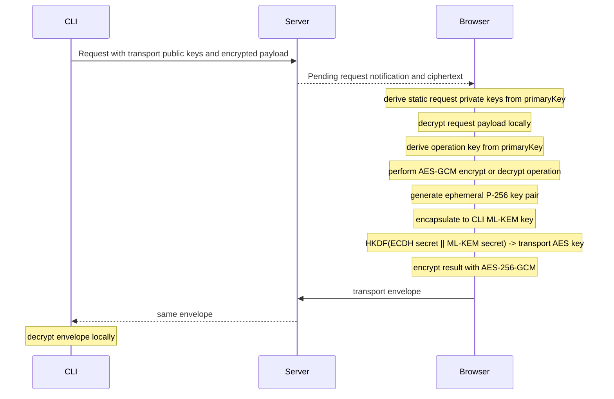

This document describes the cryptography used by Revaulter v2 as it exists today in the browser client, CLI protocol, and server-side storage model.
It focuses on how WebAuthn PRF, WebCrypto, optional passwords, the primary key, and request/response envelopes fit together.

Revaulter is designed so the server relays and stores encrypted material, but the browser performs the sensitive cryptographic operations.
The server never derives the user's primary key, never performs the requested application encryption or decryption itself, and never sees clear-text payloads.

## High-level model

Revaulter has three distinct key layers:

1. `prfSecret`: a 32-byte secret returned by the authenticator through the WebAuthn PRF extension during login
2. `primaryKey`: a random 32-byte root key generated in the browser and stored on the server only in wrapped form
3. Derived keys: deterministic keys derived from the `primaryKey` for request decryption, response transport encryption, and application operations



## Browser-side crypto and WebCrypto usage

The browser uses WebCrypto for the following operations:

- Generating the random 256-bit `primaryKey`
- HKDF-SHA-256 derivation for wrapping keys, transport keys, and operation keys
- AES-256-GCM wrap and unwrap of the `primaryKey`
- AES-256-GCM encrypt and decrypt for the requested application operation
- P-256 ECDH key generation, import, export, and shared-secret derivation for response transport

Outside WebCrypto, the browser currently uses:

- WebAuthn with the PRF extension to get `prfSecret`
- [`@awasm/noble`](https://github.com/paulmillr/awasm-noble) for Argon2id (password stretching) and ChaCha20-Poly1305 (application encrypt/decrypt operations)
- [`@noble/post-quantum`](https://github.com/paulmillr/noble-post-quantum) for ML-KEM-768 encapsulation and decapsulation in the hybrid transport path
- [`@noble/curves`](https://github.com/paulmillr/noble-curves) for ECDSA P-256 signing over a prehashed 32-byte SHA-256 digest

The split matters:

- WebCrypto covers AES-GCM, HKDF, and ECDH with the browser's native cryptographic implementation
- ChaCha20-Poly1305 is provided by `@awasm/noble` because it is not exposed by WebCrypto
- ECDSA P-256 signing uses `@noble/curves` so the browser can sign a pre-hashed 32-byte SHA-256 digest directly, without WebCrypto re-hashing it (matches standard ES256 verification semantics)
- Argon2id and ML-KEM are provided by WASM libraries (`@awasm/noble` for Argon2id, `@noble/post-quantum` for ML-KEM-768) because they are not exposed by WebCrypto

## WebCrypto security notes

Revaulter uses browser-based cryptography, so the security of the application depends in part on the integrity of the browser execution environment.

Important constraints:

- WebCrypto must run in a secure context, which in practice means `https://` or `http://localhost`
- The app implements a Content Security Policy to reduce script injection risk and to harden the browser environment around the crypto code (if you run your own proxy in front of Revaulter, make sure to preserve the CSP headers)
- Even with CSP and secure-context requirements, browser-based crypto always carries residual risk because the code handling secrets executes in a general-purpose client runtime

Despite all possible mitigations, there is still a residual risk inherent with the use of browser-based cryptography:

- A malicious script that executes in the page context could potentially access plaintext inputs, the in-memory `primaryKey`, or operation results before they are re-encrypted (the primary key is only maintained in-memory and not stored in local/session storage or in a cookie to reduce this risk)
- Browser extensions, compromised dependencies, browser implementation bugs, or client-device compromise can weaken the security assumptions around in-browser cryptography
- Revaulter reduces server-side exposure, but it does not eliminate the inherent trust placed in the browser and endpoint device

## Primary key lifecycle

The `primaryKey` is the root secret for a user account.
It is generated once in the browser during setup and reused across passkeys by re-wrapping it for each credential.

Properties:

- Size: 32 bytes
- Generation: browser-side random generation through WebCrypto
- Storage: only as a wrapped blob on the server
- Exposure: kept in-memory in the browser after successful login or password unlock



## Wrapping key derivation

The wrapping key is what encrypts and authenticates the `primaryKey` for storage.
It is derived from two factors:

- Required factor: `prfSecret` from WebAuthn PRF
- Optional factor: user password

### Without a password

When the user has no password configured, the wrapping key is derived directly from the PRF output with HKDF-SHA-256:

```text
wrappingKey = HKDF-SHA-256(
  IKM  = prfSecret
  salt = empty
  info = "revaulter/v2/primaryKeyWrap\nuserId={userId}\nv=1"
  len  = 32 bytes
)
```

### With a password

When a password is configured, the password is first stretched with Argon2id and the stretched output becomes the HKDF salt:

```text
stretched = Argon2id(
  password,
  salt = 16 random bytes,
  m = 128 MiB,
  t = 4,
  p = 1,
  hashLen = 32
)

wrappingKey = HKDF-SHA-256(
  IKM  = prfSecret,
  salt = stretched,
  info = "revaulter/v2/primaryKeyWrap\nuserId={userId}\nv=1",
  len  = 32 bytes
)
```

Why this construction:

- The PRF output gives a high-entropy authenticator-bound secret
- The password adds a second factor without becoming the direct encryption key
- Argon2id raises the cost of offline password guessing if an attacker ever obtains both a wrapped key blob and the corresponding PRF secret, protecting against a compromise of the WebAuthn authenticator (passkey)
- The `userId` in HKDF `info` domain-separates wrapping keys across accounts

## Wrapped primary key format

The primary key is wrapped with AES-256-GCM.

Parameters:

- Key: 32-byte `wrappingKey`
- Nonce: random 12 bytes
- Plaintext: 32-byte `primaryKey`
- AAD: `revaulter/v2/wrapped-primary-key\nuserId={userId}\nv=1`

The stored blob is a base64url-encoded JSON envelope:

When there's a password:

```json
{
  "v": 1,
  "passwordRequired": true,
  "argon2id": {
    "m": 131072,
    "t": 4,
    "p": 1,
    "salt": "<base64url>"
  },
  "nonce": "<base64url>",
  "ciphertext": "<base64url>"
}
```

Without passwordsç

```json
{
  "v": 1,
  "passwordRequired": false,
  "nonce": "<base64url>",
  "ciphertext": "<base64url>"
}
```

Successful AES-GCM unwrap is the password check and the passkey check upon sign in.

## Deriving keys from the primary key

Once the browser has the unwrapped `primaryKey`, all further account-level crypto keys are derived from it with HKDF-SHA-256.
The current implementation uses an empty HKDF salt and purpose-specific `info` strings.

### Request decryption ECDH key pair

The browser derives a stable request-encryption P-256 ECDH private scalar from the `primaryKey`.

Process:

1. HKDF derives 384 bits with `info = revaulter/v2/requestEncKey\nuserId={userId}\nv=1`
2. The 384-bit output is reduced to a valid P-256 scalar using the FIPS 186-5 candidate-reduction method
3. The scalar is imported as a P-256 ECDH private key
4. The corresponding public key is exported and stored on the server during signup finalization

The extra 384-bit derivation length is deliberate. It keeps modular reduction bias negligible when mapping HKDF output into the P-256 scalar field.

### Request decryption ML-KEM key pair

The browser also derives a stable ML-KEM-768 key pair from the same `primaryKey`.

Process:

1. HKDF derives 512 bits with `info = revaulter/v2/requestEncMlkemSeed\nuserId={userId}\nv=1`
2. That seed is used to deterministically derive the ML-KEM-768 key pair
3. The public key is stored on the server during signup finalization

These two static public keys let the CLI encrypt request payloads end-to-end to the browser without the server being able to decrypt them.

### Operation keys

For each actual requested encryption or decryption operation, the browser derives a 256-bit operation key from the `primaryKey` using:

```text
info = "algorithm={algorithm}\nkeyLabel={keyLabel}\nuserId={userId}\nv=1"
```

This means the same account root key can deterministically produce distinct operation keys for different labels and algorithms.

The browser accepts both JOSE-style (`A256GCM`, `C20P`) and long-form (`aes-256-gcm`, `chacha20-poly1305`) algorithm names, case-insensitive on both sides. The server applies the same set in `IsSupportedEncryptionAlgorithm`.

Before being bound into HKDF info, the algorithm string is canonicalized to its long-form name (`aes-256-gcm` or `chacha20-poly1305`). Encrypt and decrypt may therefore use any accepted spelling — both forms derive the same operation key. AAD strings (transport AAD and request-encryption AAD) are still bound verbatim, so the CLI and browser must use matching spellings within a single request.

AES-256-GCM is provided by WebCrypto; ChaCha20-Poly1305 is provided by `@awasm/noble`.

### Signing keys

For the `sign` operation, the browser derives a deterministic ECDSA P-256 private scalar from the `primaryKey`:

1. HKDF derives 384 bits with `info = "revaulter/v2/signingKey\nalgorithm={algorithm}\nkeyLabel={keyLabel}\nuserId={userId}\nv=1"`
2. The 384-bit output is reduced to a valid P-256 scalar using the FIPS 186-5 Appendix A.2.1 candidate-reduction method
3. The scalar is used directly with `@noble/curves` to sign the 32-byte SHA-256 digest with `prehash: false`, so the signature is over the supplied digest with no additional hashing

Because this info string is distinct from `revaulter/v2/requestEncKey`, `revaulter/v2/requestEncMlkemSeed`, and the symmetric operation info format, signing keys are domain-separated from every other key family — deriving the same scalar as any other key family is computationally infeasible.

Key stability:

- The signing key is a pure function of `primaryKey`, `userId`, `keyLabel`, and `algorithm`
- Password changes and credential changes only re-wrap the `primaryKey`; they do not change it
- Therefore, published signing public keys remain stable across password rotation and passkey management
- The browser does not cache derived signing keys on disk; they are re-derived from the in-memory `primaryKey` as needed



### Publication of signing public keys

Signing public keys can optionally be published on the server so external verifiers can fetch them by a stable key ID.

- The key ID is the RFC 7638 JWK thumbprint of the EC public key: base64url-encoded SHA-256 over the canonical JSON `{"crv":"P-256","kty":"EC","x":"…","y":"…"}`
- There is no soft-delete or revocation list. Consumers should treat a "not found" (i.e. 404 status code) on a known key ID as revocation
- Public endpoints are unauthenticated and take only the opaque key ID; there is no listing or enumeration endpoint

## Signup flow

Signup is split so the server first creates the user and credential record, then the browser finishes local cryptographic setup and uploads the wrapped key and static public keys.



At this stage the server stores:

- User record with request routing metadata and user-level `wrappedKeyEpoch`
- Credential record with that credential's `wrappedPrimaryKey`
- Static request decryption public keys

## Login and unlock flow

### Passwordless account

If the wrapped envelope says `passwordRequired: false`, login is a one-step unwrap after WebAuthn:



### Password-protected account

If the wrapped envelope says `passwordRequired: true`, login becomes a WebAuthn step followed by local password unlock:



Notable behavior:

- Password bytes are used exactly as entered
- Unlock failure (generally indicating an incorrect password) is detected only by AES-GCM authentication failure during unwrap

## Changing or removing the password

Changing the password does not change the `primaryKey`.
It only changes how that same `primaryKey` is wrapped for the currently authenticated credential.

Current implementation steps:

1. The browser must already have `prfSecret`, the unwrapped `primaryKey`, and the active credential ID in memory
2. The browser increments the user-level `wrappedKeyEpoch`
3. The browser derives a new wrapping key using the current passkey's `prfSecret` and the new password, or no password if removing it
4. The browser wraps the same `primaryKey` into a new envelope with a fresh nonce and, when applicable, a fresh Argon2id salt
5. The browser uploads the new wrapped blob only for the currently authenticated credential



This is a re-wrap, not a re-key:

- The account root key stays the same
- Derived operation keys stay the same
- Existing encrypted data does not need to be re-encrypted

## Multi-passkey behavior and wrapped-key epochs

Each credential stores its own wrapped copy of the same `primaryKey`.
That is necessary because each passkey yields a different `prfSecret`, so each credential needs its own wrapper.

The user record also stores a user-level `wrappedKeyEpoch`.
That epoch is used to detect that some credentials still have stale wrappers.

Behavior after a password change:

- The credential used to perform the password change is updated immediately
- Other credentials keep their older wrapped blob until they log in again
- On login, the server tells the browser whether the credential's wrapped-key epoch is stale
- The browser can still unlock using the old wrapper
- After successful unlock, the browser immediately re-wraps the same `primaryKey` for that credential and uploads a fresh wrapper at the current epoch



This design avoids global re-encryption work while still converging every credential to the current password state over time.

## Device credentials

Native apps can't use passkeys: Apple only allows an app to use passkeys for domains it declares in advance, and every Revaulter server has its own domain.
Instead, each app install registers a device credential, made of four keys that are created in the Secure Enclave and can't be exported.

| Key | Algorithm | Public key | Used to |
| --- | --- | --- | --- |
| `signP256` | ECDSA P-256 | 65 bytes, uncompressed | Sign the login challenge |
| `signMldsa65` | ML-DSA-65 | 1,952 bytes | Sign the same login challenge |
| `kaP256` | ECDH P-256 | 65 bytes, uncompressed | Agree on a secret with a wrapper's ephemeral key |
| `kemMlkem768` | ML-KEM-768 | 1,184 bytes | Decapsulate a wrapper's ciphertext |

A device credential is used exactly like a passkey for the primary key: it has its own wrapped copy of the same `primaryKey` and of the anchor key, at an epoch, and the optional password applies to it in the same way.
What changes is where the secret that replaces `prfSecret` comes from, and how the device logs in.

The server enforces a few rules on top:

- Accounts are created in the web app, so the first credential is always a passkey
- Devices are only added by [pairing](#pairing)
- A credential can't be deleted if no passkey would remain, so losing every device can't lock the account out
- Device credentials are never loaded into the WebAuthn library, and device logins have their own endpoints, so a device signature can't be mistaken for a passkey assertion

The public keys are stored as JSON, and the anchor attestation covers their hash:

```text
credentialPublicKeyHash = base64url(SHA-256(
  "revaulter/v2/device-public-keys\n" ||
  "signP256={signP256}\nkaP256={kaP256}\nsignMldsa65={signMldsa65}\nkemMlkem768={kemMlkem768}\nv=1"
))
```

### Device wrapper

The Secure Enclave has no HMAC, so it can't compute a PRF the way a passkey does.
A hybrid key encapsulation does the same job: wrapping needs only the device's public keys, and unwrapping needs both private keys, which never leave the Secure Enclave.

```text
# Wrap, on any unlocked client, fresh for every wrap
eph            = new P-256 key pair
ssEcdh         = ECDH(eph, kaP256)
(kemCt, ssKem) = ML-KEM-768.Encapsulate(kemMlkem768)

deviceSecret = HKDF-SHA-256(
  IKM  = ssEcdh || ssKem
  salt = empty
  info = "revaulter/v2/deviceUnlock\n"
       + "credentialId={credentialId}\n"
       + "ephPub={base64url(eph public key)}\n"
       + "kemCtHash={base64url(SHA-256(kemCt))}\n"
       + "userId={userId}\nv=1"
  len  = 32 bytes
)
```

`deviceSecret` then takes the place of `prfSecret` in the [wrapping key derivation](#wrapping-key-derivation), with or without a password.
The device repeats the same steps with its private keys: ECDH with `ephPub`, decapsulation of `kemCt`, then the same two HKDF calls and the AES-GCM unwrap.

The envelope adds the two values the device needs, and its AAD is unchanged:

```json
{
  "v": 1,
  "kind": "device",
  "passwordRequired": false,
  "ephPub": "<base64url, 65 bytes>",
  "kemCt": "<base64url, 1088 bytes>",
  "nonce": "<base64url, 12 bytes>",
  "ciphertext": "<base64url, 48 bytes>"
}
```

Properties:

- An attacker needs both shared secrets: breaking P-256 reveals only `ssEcdh`, and breaking ML-KEM reveals only `ssKem`
- The HKDF info binds the credential ID, the ephemeral key and the ciphertext, so a wrapper can't be moved to another credential
- Because wrapping needs only public keys, a password change can re-wrap every device in the same request, through the `updates` list of `POST /v2/auth/update-wrapped-key`, instead of waiting for each one to log in
- A client must only wrap to device keys covered by a valid anchor attestation, or during pairing by the pairing MAC: otherwise a malicious server could substitute its own keys and receive the primary key. `GET /v2/auth/credentials` returns each device's keys with its attestation for this check

### Device login

A device logs in by signing a server-issued challenge with both signing keys:

```text
message = "revaulter/v2/device-login\n"
        + "challenge={base64url(challenge)}\n"
        + "credentialId={credentialId}\n"
        + "userId={userId}\nv=1"

signatureP256    = ECDSA-P256(SHA-256(message)), raw r || s, 64 bytes
signatureMldsa65 = ML-DSA-65(message), empty context, 3,309 bytes
```

The challenge is 32 random bytes, single-use, and expires after 60 seconds.
The server rebuilds the message from its own state (the challenge it issued and the stored credential and user IDs) and accepts the login only if both signatures verify.
There is no signature counter: Secure Enclave keys can't be cloned.

The response carries the session token, which the app sends as a bearer token, and the device's wrapped keys.
Delivery of wrapped keys is rate-limited per user exactly as for passkey logins.

## Pairing

A new device can't unwrap anything until a client that is already unlocked builds a wrapper for it.
Pairing connects the two through the server, authenticated by a secret that only travels out of band.

The existing client opens a pairing session and shows a payload as a QR code, a `revaulter://pair/` link or text:

```text
payload = "revaulter-pair:" + base64url(
  "server={server}\nuserId={userId}\nsessionId={sessionId}\nsecret={secret}\nanchorFingerprint={fingerprint}\nv=1"
)
```

`sessionId` is 16 random bytes from the server and `secret` is 32 random bytes from the client, which never reach the server.
The new device pins the anchor fingerprint from the payload, so it doesn't rely on trust on first use.
Every message relayed between the two clients is authenticated with a key derived from the secret:

```text
macKey = HKDF-SHA-256(IKM = secret, salt = empty, info = "revaulter/v2/pair/mac\nsessionId={sessionId}\nv=1", len = 32)
```



The hello's two signatures and its MAC cover the same transcript, which binds the device's keys to this session's payload:

```text
transcript = "revaulter/v2/pair/hello\n"
           + "server={server}\nuserId={userId}\nsessionId={sessionId}\nanchorFingerprint={fingerprint}\n"
           + "credentialId={credentialId}\ndeviceName={deviceName}\n"
           + "signP256={signP256}\nkaP256={kaP256}\nsignMldsa65={signMldsa65}\nkemMlkem768={kemMlkem768}\nv=1"

helloMac = HMAC-SHA-256(macKey, transcript)
```

The signatures prove the device holds its signing keys; the server checks them, rebuilding the transcript from the session.
Only the existing client can check the MAC, which proves the device saw the payload.

After accepting the hello, the existing client picks a fresh 32-byte nonce, and both sides compute the comparison code from it:

```text
nonceBody = "helloMac={base64url(helloMac)}\nnonce={base64url(nonce)}\nv=1"
nonceMac  = HMAC-SHA-256(macKey, "revaulter/v2/pair/nonce\n" || nonceBody)
code      = first 4 bytes of HMAC-SHA-256(macKey, "revaulter/v2/pair/code\n" || nonceBody), big-endian, mod 10^6
```

The nonce is chosen only after the hello is fixed, so someone who photographed the payload can't pick device keys that produce a matching code.

Once the user confirms that the codes match, the existing client wraps the primary key and the anchor key for the device, and signs a version 2 credential attestation with the anchor (ES384 and ML-DSA-87):

```text
"revaulter/v2/cred-attest\n"
+ "userId={userId}\ncredentialId={credentialId}\ncredentialType=device\n"
+ "credentialPublicKeyHash={credentialPublicKeyHash}\nwrappedKeyEpoch={epoch}\ncreatedAt={unix seconds}\nv=2"
```

The server checks the attestation against the user's anchor and every field against the session's hello and the user's current epoch, then stores the credential and closes the session in one transaction.
The new device logs in, unwraps the primary key, and verifies its own attestation and the public key bundle against the pinned anchor.

The server sees the session ID, the device's public keys and signatures, the MACs and the nonce, the wrappers and the attestation.
It never sees the payload secret, the primary key, the anchor private key, the password, or the code.

A session expires after 5 minutes, accepts a single hello and a single nonce, and opening a new session cancels the user's previous one.
A password change is refused while a session is open, since the existing client wraps for the device with the current password.

## Request encryption path

When the CLI submits an encrypt, decrypt, or sign request, it does not send the sensitive request body in plaintext to the server.
Instead it encrypts the request to the browser's static request keys derived from the `primaryKey`.

High-level shape:

1. Browser derives static request private keys from `primaryKey`
2. CLI uses the corresponding server-stored public keys to build an end-to-end encrypted request payload
3. Server stores and relays that ciphertext
4. Browser decrypts the request locally after the user approves it

The request AAD format is deterministic and currently follows:

```text
aad = "algorithm={algorithm}\nkeyLabel={keyLabel}\noperation={encrypt|decrypt|sign}\nv=1"
```

That binds the encrypted request to the intended algorithm and key label.

For `sign`, the inner payload carries only the 32-byte SHA-256 digest of the message (base64url). The CLI always pre-hashes client-side, so the browser and server only ever see the digest, never the original message.

## Response transport encryption path

The browser sends the result back to the CLI through a separate transport envelope.
This path is hybrid:

- Key agreement using hybrid P-256 ECDH + ML-KEM-768
- Key derivation using HKDF-SHA-256
- Encryption with AES-256-GCM

The browser generates a fresh ephemeral P-256 key pair for each response.
It also encapsulates to the CLI's ML-KEM public key.
The ECDH shared secret and ML-KEM shared secret are concatenated and expanded with HKDF into an AES-256-GCM key.

Current HKDF `info` for transport is:

```text
info = "revaulter/v2/transport/{state}"
```

The transport AAD is deterministic and currently serialized as:

```text
aad = "algorithm={algorithm}\noperation={encrypt|decrypt|sign}\nstate={state}\nv=1"
```



This hybrid transport gives the response envelope both conventional ECDH confidentiality and a post-quantum KEM component.

## Algorithms in use

| Purpose | Algorithm |
|---------|-----------|
| Authenticator-bound secret | WebAuthn PRF |
| Password stretching | Argon2id (`m=128 MiB`, `t=4`, `p=1`, `hashLen=32`) |
| Key derivation | HKDF-SHA-256 |
| Wrapped primary key encryption | AES-256-GCM |
| Application encrypt/decrypt operation | AES-256-GCM (via WebCrypto) or ChaCha20-Poly1305 (via `@awasm/noble`); accepted as JOSE-style (`A256GCM`, `C20P`) or long-form (`aes-256-gcm`, `chacha20-poly1305`) names — case-insensitive. The response transport AEAD remains AES-256-GCM only |
| Application sign operation | ECDSA P-256 (`ES256`) via `@noble/curves`, signed over the supplied 32-byte SHA-256 digest (prehashed; no re-hashing) |
| Published signing key ID | RFC 7638 JWK thumbprint (SHA-256, base64url) |
| Static request key agreement | ECDH P-256 |
| Response transport KEM | ML-KEM-768 |
| Response transport AEAD | AES-256-GCM |
| Device unlock secret | ECDH P-256 and ML-KEM-768 in the Secure Enclave, combined with HKDF-SHA-256 |
| Device login | ECDSA P-256 and ML-DSA-65 in the Secure Enclave |
| Pairing messages | HMAC-SHA-256, keyed with HKDF-SHA-256 from the payload secret |
| Credential attestation | ES384 and ML-DSA-87, signed by the anchor |

## Security properties and consequences

- The server cannot perform user cryptographic operations because it never has the unwrapped `primaryKey`
- A passkey change or password change normally requires only re-wrapping, not re-encrypting application data
- A successful unwrap authenticates the wrapper contents, the passkey-derived PRF input, and the optional password in one step
- Distinct HKDF `info` strings domain-separate wrapping keys, static request keys, transport keys, and operation keys
- User ID and request metadata are bound into AAD or HKDF context to prevent cross-context key reuse
- A device wrapper needs both the classical and the post-quantum shared secret, and a device login needs both signatures
- The server can't add a device on its own: a client only wraps the primary key to keys covered by the pairing MAC or an anchor attestation
