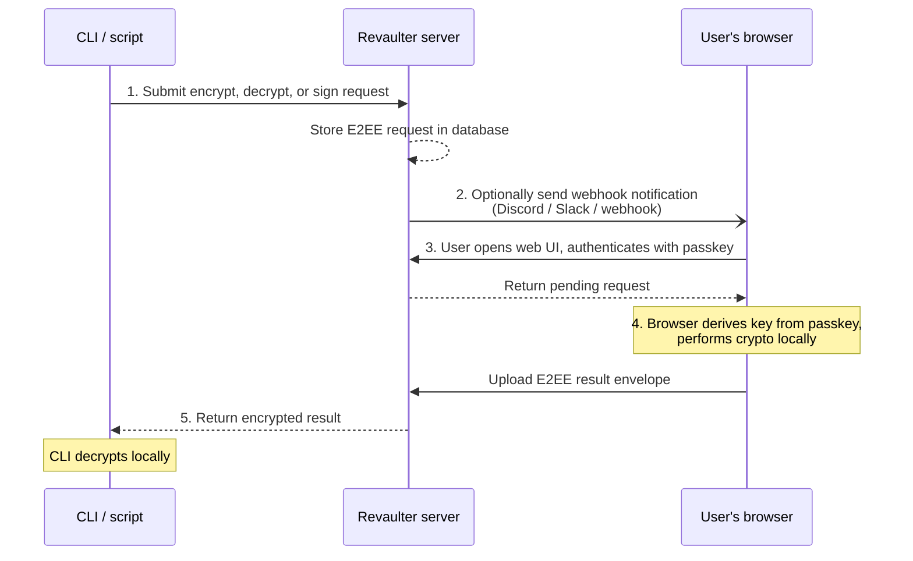

Revaulter is a self-hosted service that turns WebAuthn passkeys into encryption keys.

Instead of storing keys on a server or in a vault, Revaulter derives them from a passkey directly in the user's browser, and the server never sees them. When a CLI or script needs to encrypt, decrypt, or sign something, the passkey holder authenticates and the browser performs the operation locally.

## How it works

1. A CLI or script submits an encrypt, decrypt, or sign request to Revaulter, authenticated with a per-user request key or with a short-lived [OIDC token](/docs/oidc-authentication/), such as the ones GitHub Actions issues to workflows.
2. Revaulter stores the End-to-End Encrypted (E2EE) request in its database and, if configured, sends a webhook notification to the passkey holder.
3. The user opens the Revaulter web UI and authenticates with their WebAuthn passkey, plus a password if they set one.
4. The browser derives the key from the passkey via WebAuthn PRF, performs the cryptographic operation locally, and encrypts the result for the CLI. The server never sees the plaintext or the user's keys.
5. The encrypted result is relayed back to the CLI, which decrypts it locally using its ephemeral private key.

## Security model

Encryption keys are derived from the passkey in the browser and never leave the user's device. The server acts as a relay, not a key service:

- Passkey-derived keys: the user's keys are derived from the WebAuthn PRF extension output, so they exist only when the passkey holder authenticates.
- The server never derives or holds the user's keys.
- The server never performs the requested encryption or decryption itself.
- The server never sees plaintext payloads: it stores only opaque, encrypted envelopes.
- All sensitive cryptographic operations happen in the user's browser using the [Web Crypto API](https://developer.mozilla.org/en-US/docs/Web/API/Web_Crypto_API) or JavaScript-browser cryptography ([noble](https://paulmillr.com/noble/)).
- Request payloads are encrypted end-to-end between the CLI and the browser.
- Requests and responses are encrypted with hybrid ECDH P-256 + ML-KEM-768 key agreement, for post-quantum protection.

For a full description of the cryptographic architecture, see [Cryptography architecture](/docs/crypto-architecture).

## Self-hosted

Revaulter runs on your own infrastructure. You deploy the server, you own the database, and you control access. There are no external dependencies or third-party services required beyond what you configure.

Requirements are minimal:

- A container runtime (Docker, Podman, etc.)
- A database: **SQLite** (file-based) or **PostgreSQL**
- HTTPS access for the web UI, via TLS certificates or a reverse proxy (passkeys and WebCrypto only work over HTTPS)

See [Installing Revaulter](/docs/installing-revaulter) for setup instructions.

## Supported passkeys

Using Revaulter requires passkeys with support for the PRF extension, which must be supported by both the authenticator and the platform.

PRF (Pseudo-Random Function) lets Revaulter ask a passkey for a secret value after a successful WebAuthn ceremony. The passkey always returns the same value, and every passkey returns a different one. Revaulter uses that output to derive the user's keys in the browser.

Some supported configurations include:

- macOS/iOS: Safari with Apple/iCloud Passkeys, on iOS 18.4+ and macOS 15+ (with Safari 18+)
- Chrome/Edge on macOS 15+ with iCloud Passkeys or Security Keys
- Chrome/Edge on Windows 11 with Security Keys
- Chrome/Edge or Samsung Internet on Android, with Google Password Manager or Security Keys
- 1Password on macOS 15+, Android, and iOS 18.4+

Support depends on the complete browser, operating system, passkey provider, and authenticator combination. If Revaulter reports that PRF is unavailable, try another configuration from the list above.

## Supported operations

Revaulter supports three operations:

- **Encrypt:** encrypt a value with AES-256-GCM (`A256GCM`) or ChaCha20-Poly1305 (`C20P`)
- **Decrypt:** decrypt a value encrypted with one of those algorithms
- **Sign:** sign data with ECDSA P-256 (`ES256`), Ed25519 (`Ed25519`), or Ed25519ph (`Ed25519ph`)

Encryption keys and signing keys are derived from the passkey holder's primary key, the key label, and the algorithm, so the same inputs always produce the same key. You can publish signing public keys, so others can fetch them by a stable key ID in JWK or PEM form. See the [cryptography architecture](/docs/crypto-architecture) for details.

## Webhook notifications

When `webhookUrl` is configured, Revaulter sends a webhook notification when a request is submitted, so the passkey holder knows a request is waiting. Set `webhookFormat` to one of these formats:

- `plain` (default): plain text body (`text/plain`), for any generic webhook receiver
- `slack`: Slack-compatible JSON payload, for Slack and Slack-compatible services
- `discord`: Discord webhook, using Discord's Slack-compatible format
- `ntfy`: publishes to an [ntfy](https://ntfy.sh) topic (the URL must include the topic, such as `https://ntfy.sh/mytopic`)
- `telegram`: sends a message with a Telegram bot (the URL must be like `https://api.telegram.org/bot<token>/sendMessage?chat_id=<chat>`)
- `googlechat`: Google Chat incoming webhook
- `teams`: Microsoft Teams, via a Workflows webhook like the one created by the "Send webhook alerts to a channel" template

Webhook notifications include:

- The operation (encrypt, decrypt, or sign)
- The key label
- The user the request is for
- The requestor's IP address
- The note from the CLI, if any
- A link to open the Revaulter web UI

Set `webhookKey` to send an `Authorization` header with each webhook request.

By default, Revaulter refuses to send webhooks to private, loopback, and link-local addresses. If your notification receiver runs on your own network, set `webhookAllowPrivateAddresses` to `true`.
